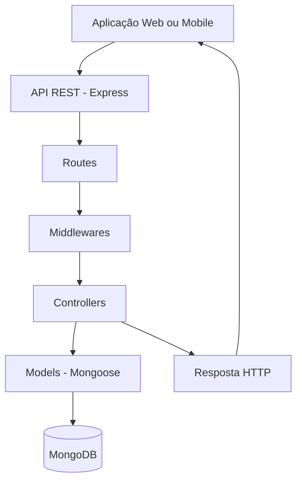
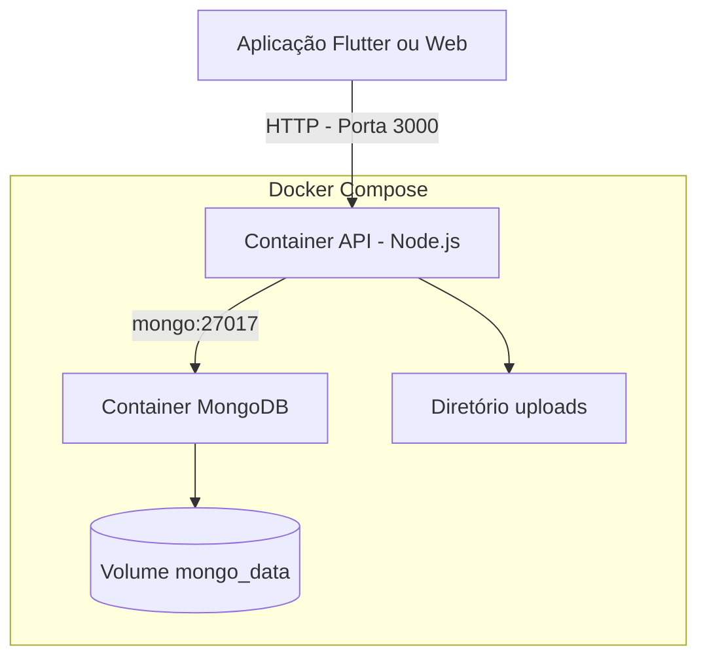
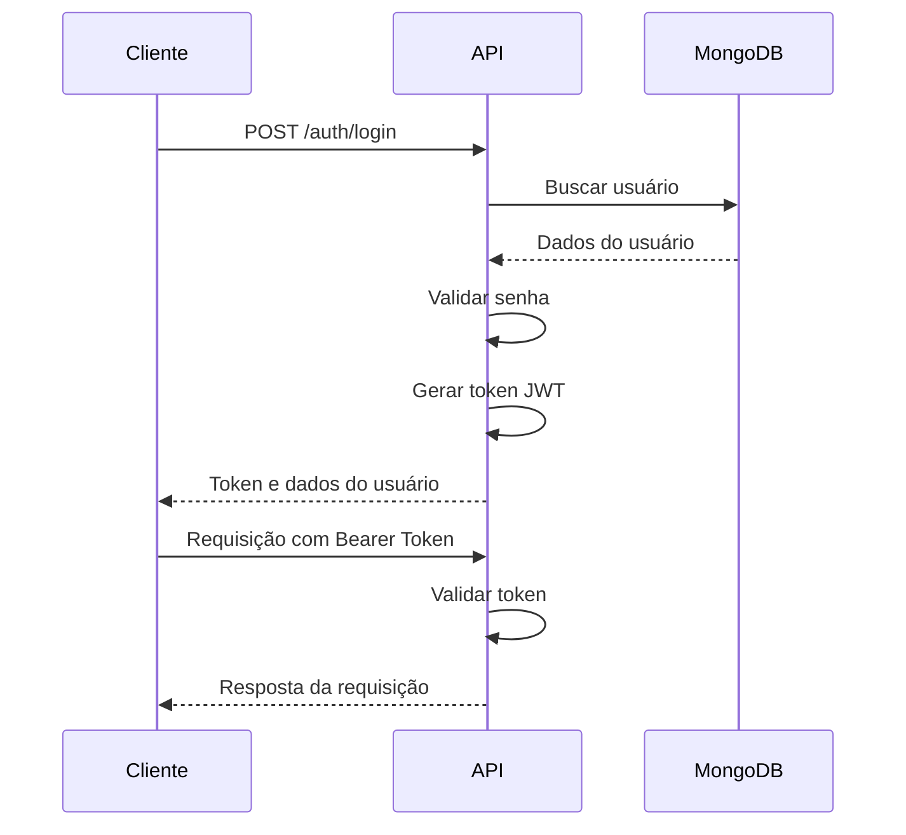
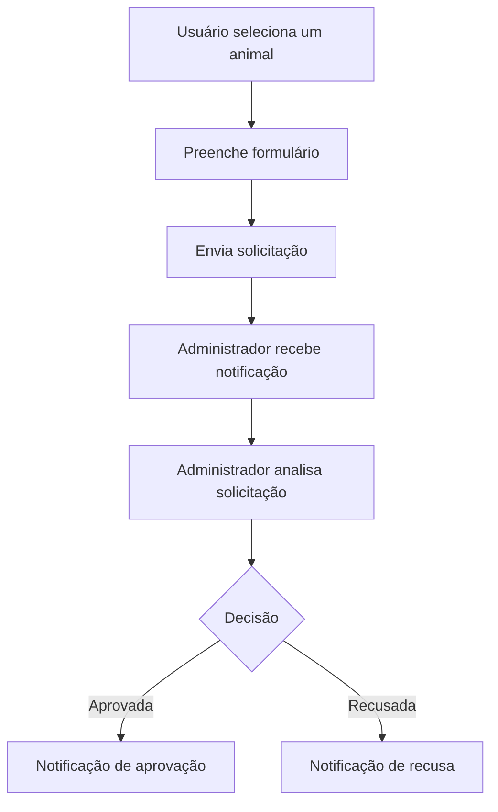
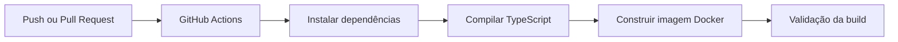

# 🐾 ATIPATTAS — OngAdocaoAPI


## 📖 Sobre o projeto

A ATIPATTAS é uma API REST desenvolvida para auxiliar no gerenciamento e na adoção responsável de animais.

O sistema centraliza o cadastro de animais, usuários, eventos, solicitações de adoção e notificações, disponibilizando serviços para integração com aplicações web e mobile.

## 🚀 Funcionalidades

- Cadastro e gerenciamento de usuários.
- Autenticação utilizando JWT.
- Criação automática do administrador.
- Recuperação de senha por código enviado por e-mail.
- Cadastro, edição, listagem e exclusão de animais.
- Upload de imagens dos animais.
- Gerenciamento de eventos.
- Envio de solicitações de adoção.
- Aprovação e recusa de solicitações pelo administrador.
- Sistema de notificações.
- Controle de acesso por perfil de usuário.
- Documentação interativa com Swagger.
- Containerização com Docker.
- Integração contínua com GitHub Actions.

## 🛠️ Tecnologias utilizadas

| Tecnologia | Finalidade |
|---|---|
| Node.js 24 | Ambiente de execução |
| TypeScript | Linguagem de programação |
| Express 5 | Desenvolvimento da API REST |
| MongoDB 8 | Banco de dados NoSQL |
| Mongoose | Modelagem e manipulação dos dados |
| JWT | Autenticação e autorização |
| Bcrypt.js | Criptografia hash de senhas |
| Multer | Upload de imagens |
| Nodemailer | Envio de e-mails |
| CORS | Comunicação com aplicações externas |
| Swagger | Documentação da API |
| Docker | Containerização |
| Docker Compose | Gerenciamento dos containers |
| GitHub Actions | Integração contínua |

## 📂 Estrutura do projeto

```text
OngAdocaoAPI/
├── .github/
│   └── workflows/
│       └── ci.yml
├── src/
│   ├── config/
│   ├── controllers/
│   ├── interfaces/
│   ├── middlewares/
│   ├── models/
│   ├── routes/
│   ├── app.ts
│   └── server.ts
├── uploads/
├── .env.example
├── .dockerignore
├── .gitignore
├── Dockerfile
├── docker-compose.yml
├── package.json
├── package-lock.json
├── tsconfig.json
└── README.md
```

### Responsabilidades das camadas

- **Config:** configurações do banco de dados, administrador e Swagger.
- **Controllers:** regras de negócio e processamento das requisições.
- **Interfaces:** definição dos contratos e tipos TypeScript.
- **Middlewares:** autenticação, autorização e upload de arquivos.
- **Models:** definição dos schemas do MongoDB.
- **Routes:** definição dos endpoints da API.
- **app.ts:** configuração do Express e seus middlewares.
- **server.ts:** conexão com o banco e inicialização do servidor.
- **Uploads:** armazenamento das imagens cadastradas.

## 🏗️ Arquitetura da aplicação



A aplicação utiliza uma arquitetura em camadas, permitindo a separação de responsabilidades, facilitando a manutenção, organização e evolução do código.

## ⚙️ Instalação

### Clonar o repositório

```bash
git clone https://github.com/octaviohrngr/OngAdocaoAPI.git
```

Acesse a pasta do projeto:

```bash
cd OngAdocaoAPI
```

### Configurar as variáveis de ambiente

Crie um arquivo `.env` na raiz do projeto ou utilize o arquivo de exemplo:

```bash
cp .env.example .env
```

Configure as seguintes variáveis:

```env
PORT=3000

MONGO_URI=mongodb://localhost:27017/OngAdocaoAPI

JWT_SECRET=sua_chave_secreta
JWT_EXPIRES_IN=1d

EMAIL_USUARIO=seuemail@gmail.com
EMAIL_SENHA=sua_senha_de_aplicativo

SEGREDO_RECUPERACAO=seu_segredo_de_recuperacao

ADMIN_EMAIL=admin@ong.com
ADMIN_PASSWORD=sua_senha_segura
```

### Descrição das variáveis

| Variável | Descrição |
|---|---|
| PORT | Porta de execução da API |
| MONGO_URI | Endereço de conexão com o MongoDB |
| JWT_SECRET | Chave utilizada na autenticação JWT |
| JWT_EXPIRES_IN | Validade do token; atualmente definida como 1d no código |
| EMAIL_USUARIO | E-mail responsável pelo envio de mensagens |
| EMAIL_SENHA | Senha de aplicativo do e-mail |
| SEGREDO_RECUPERACAO | Chave utilizada na recuperação de senha |
| ADMIN_EMAIL | E-mail do administrador inicial |
| ADMIN_PASSWORD | Senha do administrador inicial |

Para gerar uma chave secreta segura:

```bash
openssl rand -hex 32
```

Execute separadamente para cada segredo.

> Nunca compartilhe ou envie o arquivo `.env` para o GitHub.

## 🐳 Executando com Docker

### Pré-requisitos

- Docker Engine.
- Docker Compose v2.

Para construir a imagem e iniciar os containers:

```bash
docker compose up -d --build
```

Serão iniciados dois containers:

| Container | Responsabilidade |
|---|---|
| ongadocao-api | Executar a API Node.js |
| ongadocao-mongo | Executar o banco MongoDB |

### Arquitetura Docker



### Dockerfile

O Dockerfile utiliza uma estratégia de construção em múltiplos estágios, conhecida como Multi-stage Build.

Na primeira etapa:

- Utiliza a imagem Node.js.
- Instala as dependências do projeto.
- Copia os arquivos TypeScript.
- Realiza a compilação para JavaScript.

Na segunda etapa:

- Instala somente as dependências de produção.
- Copia os arquivos compilados da pasta `dist`.
- Prepara o diretório de uploads.
- Executa a aplicação como usuário `node`.

Essa abordagem reduz o tamanho da imagem final e evita a inclusão de dependências desnecessárias.

### Docker Compose

O Docker Compose é responsável por:

- Construir a imagem da API.
- Criar e iniciar os containers.
- Configurar a comunicação entre os serviços.
- Configurar as variáveis de ambiente.
- Verificar a disponibilidade do MongoDB através do healthcheck.
- Iniciar a API após o banco estar disponível.
- Gerenciar a persistência dos dados.
- Reiniciar automaticamente os serviços em caso de falha.

### Persistência dos dados

Os dados do MongoDB são armazenados no volume:

```yaml
volumes:
  mongo_data:
```

As imagens são armazenadas utilizando um bind mount:

```yaml
volumes:
  - ./uploads:/app/uploads
```

Dessa forma, os dados e imagens são preservados mesmo quando os containers são removidos, desde que os volumes e arquivos sejam mantidos.

### Configuração do banco no Docker

Dentro da rede do Docker, a conexão utiliza o nome do serviço MongoDB:

```env
MONGO_URI=mongodb://mongo:27017/OngAdocaoAPI
```

### Configuração de e-mail no Docker

Para utilizar a recuperação de senha dentro do container, acrescente as seguintes variáveis ao bloco `environment` do serviço `api` no Docker Compose:

```yaml
SEGREDO_RECUPERACAO: ${SEGREDO_RECUPERACAO}
EMAIL_USUARIO: ${EMAIL_USUARIO}
EMAIL_SENHA: ${EMAIL_SENHA}
```

Depois, recrie o container:

```bash
docker compose up -d --force-recreate api
```

### Comandos úteis do Docker

| Comando | Descrição |
|---|---|
| `docker compose up -d --build` | Construir e iniciar os containers |
| `docker compose ps` | Listar containers ativos |
| `docker compose ps -a` | Listar todos os containers do projeto |
| `docker compose stop` | Parar os containers |
| `docker compose start` | Iniciar os containers |
| `docker compose restart` | Reiniciar os containers |
| `docker compose restart api` | Reiniciar somente a API |
| `docker compose logs -f api` | Visualizar logs da API |
| `docker compose logs -f mongo` | Visualizar logs do banco |
| `docker compose down` | Remover containers e rede |

> Não execute `docker compose down -v` caso queira preservar os dados armazenados no MongoDB.

## 💻 Executando localmente sem Docker

### Pré-requisitos

- Node.js 24.
- NPM.
- MongoDB instalado ou uma instância MongoDB acessível.

Instale as dependências:

```bash
npm ci
```

Configure o endereço do banco no `.env`:

```env
MONGO_URI=mongodb://localhost:27017/OngAdocaoAPI
```

Inicie a aplicação em modo de desenvolvimento:

```bash
npm run dev
```

Para compilar o projeto:

```bash
npm run build
```

Para executar a versão compilada:

```bash
npm start
```

### Utilizando MongoDB Atlas

Também é possível utilizar o MongoDB Atlas.

Configure a variável `MONGO_URI` com a string de conexão disponibilizada pelo Atlas e autorize o endereço IP de origem nas configurações de acesso à rede.

### Executando somente o MongoDB no Docker

Adicione ao serviço `mongo` do Docker Compose:

```yaml
ports:
  - "127.0.0.1:27017:27017"
```

Pare o container da API:

```bash
docker compose stop api
```

Inicie somente o banco:

```bash
docker compose up -d mongo
```

Configure o `.env`:

```env
MONGO_URI=mongodb://localhost:27017/OngAdocaoAPI
```

Execute a API:

```bash
npm run dev
```

> Não execute a API pelo Docker e pelo NPM simultaneamente na mesma porta.

## 📚 Documentação Swagger

A API possui documentação interativa utilizando Swagger e OpenAPI 3.0.

Após iniciar o servidor, acesse:

### API

http://localhost:3000

### Swagger

http://localhost:3000/api-docs

### Arquivos de imagens

http://localhost:3000/uploads/nome-do-arquivo

O Swagger permite:

- Visualizar os endpoints disponíveis.
- Consultar os parâmetros das requisições.
- Verificar os modelos de dados.
- Realizar testes diretamente pelo navegador.
- Autenticar utilizando JWT.
- Consultar os possíveis retornos HTTP.

## 🔐 Autenticação

A API utiliza JSON Web Token (JWT) para autenticar os usuários e proteger as rotas.

Durante a inicialização, o sistema verifica se existe um administrador cadastrado. Caso não exista, realiza sua criação automaticamente utilizando as variáveis de ambiente.

Alterar as variáveis do administrador não modifica automaticamente um administrador já cadastrado.

### Realizar login

```http
POST /auth/login
```

Corpo da requisição:

```json
{
  "email": "admin@ong.com",
  "senha": "sua_senha"
}
```

Após realizar o login, a API retorna um token de autenticação e os dados do usuário.

Para acessar rotas protegidas, envie o token no cabeçalho:

```http
Authorization: Bearer SEU_TOKEN
```

### Fluxo de autenticação



## 📌 Endpoints da API

### Autenticação

| Método | Endpoint | Acesso | Descrição |
|---|---|---|---|
| POST | `/auth/login` | Público | Realizar login |
| POST | `/auth/solicitar-codigo` | Público | Solicitar código de recuperação |
| POST | `/auth/verificar-codigo` | Público | Verificar código |
| POST | `/auth/redefinir-senha` | Público | Redefinir senha |

### Usuários

| Método | Endpoint | Acesso | Descrição |
|---|---|---|---|
| POST | `/usuarios` | Público | Cadastrar usuário |
| GET | `/usuarios` | JWT | Listar usuários |
| GET | `/usuarios/:id` | JWT | Buscar usuário |
| PUT | `/usuarios/:id` | JWT | Atualizar usuário |
| DELETE | `/usuarios/:id` | Admin | Excluir usuário |

### Animais

| Método | Endpoint | Acesso | Descrição |
|---|---|---|---|
| POST | `/animais` | Admin | Cadastrar animal |
| GET | `/animais` | Público | Listar animais |
| GET | `/animais/:id` | JWT | Buscar animal |
| PUT | `/animais/:id` | Admin | Atualizar animal |
| DELETE | `/animais/:id` | Admin | Excluir animal |

### Eventos

| Método | Endpoint | Acesso | Descrição |
|---|---|---|---|
| POST | `/eventos` | Admin | Cadastrar evento |
| GET | `/eventos` | Público | Listar eventos |
| GET | `/eventos/:id` | Público | Buscar evento |
| PUT | `/eventos/:id` | Admin | Atualizar evento |
| DELETE | `/eventos/:id` | Admin | Excluir evento |

### Formulários de adoção

| Método | Endpoint | Acesso | Descrição |
|---|---|---|---|
| POST | `/formularios` | JWT | Enviar solicitação de adoção |
| GET | `/formularios` | JWT | Listar solicitações |
| GET | `/formularios/:id` | JWT | Buscar solicitação |
| PUT | `/formularios/:id` | JWT | Atualizar solicitação |
| PATCH | `/formularios/:id/status` | Admin | Alterar status |
| DELETE | `/formularios/:id` | Admin | Excluir solicitação |

### Notificações

| Método | Endpoint | Acesso | Descrição |
|---|---|---|---|
| GET | `/notificacoes` | JWT | Listar notificações |
| GET | `/notificacoes/nao-lidas` | JWT | Contar notificações não lidas |
| PATCH | `/notificacoes/:id/lida` | JWT | Marcar notificação como lida |
| PATCH | `/notificacoes/solicitacoes/lidas` | Admin | Marcar solicitações como lidas |

Os controllers podem aplicar verificações adicionais de propriedade e perfil do usuário.

## 🐶 Cadastro de animais

O cadastro de animais utiliza o formato `multipart/form-data`, permitindo o envio dos dados e das imagens em uma única requisição.

| Campo | Exemplo |
|---|---|
| nome | Rex |
| especie | cachorro |
| raca | Labrador |
| idadeEstimada | 3 |
| porte | médio |
| temperamento | Calmo |
| historicoVacina | Vacinas em dia |
| fotos | Dois arquivos de imagem |

### Formatos de imagens aceitos

- JPG.
- JPEG.
- PNG.
- WEBP.

O tamanho máximo permitido é de 5 MiB por arquivo.

### Status dos animais

- `disponivel`
- `em_processo`
- `adotado`

## 📅 Gerenciamento de eventos

O cadastro e a atualização de eventos utilizam `multipart/form-data`.

| Campo | Descrição |
|---|---|
| titulo | Título do evento |
| dataHora | Data e horário |
| localizacao | Localização do evento |
| descricao | Informações sobre o evento |
| foto | Imagem do evento |

## 📝 Solicitações de adoção

Os usuários autenticados podem enviar solicitações para adotar um animal.

Exemplo de requisição:

```http
POST /formularios
```

```json
{
  "animalId": "507f1f77bcf86cd799439011",
  "nome": "Pessoa adotante",
  "email": "adotante@example.com",
  "telefone": "11999999999",
  "tipoMoradia": "Casa",
  "tempoMedioSozinho": "4 horas",
  "mensagem": "Tenho interesse na adoção.",
  "aceitarTermos": true
}
```

O identificador do usuário é obtido através do token JWT.

O sistema possui um índice único para evitar solicitações duplicadas do mesmo usuário para o mesmo animal.

### Status das solicitações

| Status | Descrição |
|---|---|
| em_analise | Solicitação aguardando análise |
| finalizado_ok | Solicitação aprovada |
| negado | Solicitação recusada |

O administrador pode alterar o status através do endpoint:

```http
PATCH /formularios/:id/status
```

Exemplo:

```json
{
  "status": "finalizado_ok"
}
```

## 🔔 Sistema de notificações

O sistema de notificações permite informar os usuários e administradores sobre o andamento das solicitações de adoção.

### Tipos de notificações

- `nova_solicitacao`
- `adocao_aprovada`
- `adocao_negada`

### Fluxo de adoção



## 🔑 Recuperação de senha

A API possui um sistema de recuperação de senha utilizando códigos enviados por e-mail.

### Etapa 1 — Solicitar código

```http
POST /auth/solicitar-codigo
```

```json
{
  "email": "usuario@example.com"
}
```

### Etapa 2 — Verificar código

```http
POST /auth/verificar-codigo
```

```json
{
  "email": "usuario@example.com",
  "codigo": "123456"
}
```

### Etapa 3 — Redefinir senha

```http
POST /auth/redefinir-senha
```

```json
{
  "email": "usuario@example.com",
  "tokenRecuperacao": "TOKEN_RECEBIDO",
  "novaSenha": "nova_senha_segura"
}
```

## 🔄 Integração contínua — CI

O projeto utiliza GitHub Actions para automatizar a validação do processo de compilação e construção da imagem Docker.

O arquivo de configuração está localizado em:

```text
.github/workflows/ci.yml
```

O workflow é executado em pushes e pull requests direcionados à branch `main`.

### Etapas da integração contínua

1. Preparação do ambiente Ubuntu.
2. Configuração do Node.js 24.
3. Instalação das dependências.
4. Compilação do TypeScript.
5. Construção da imagem Docker.



O workflow atual não realiza deploy automático nem executa testes automatizados.

## 🗄️ Banco de dados

O projeto utiliza MongoDB, um banco de dados NoSQL orientado a documentos.

A integração entre a API e o banco é realizada através do Mongoose.

Para acessar o MongoDB dentro do Docker:

```bash
docker compose exec mongo mongosh
```

Listar os bancos disponíveis:

```javascript
show dbs
```

Selecionar o banco da aplicação:

```javascript
use OngAdocaoAPI
```

Listar as coleções:

```javascript
show collections
```

Consultar os animais cadastrados:

```javascript
db.animals.find()
```

Contar os animais:

```javascript
db.animals.countDocuments()
```

## ⚠️ Solução de problemas

| Problema | Possível solução |
|---|---|
| EAI_AGAIN mongo | Utilize localhost ao executar a API fora do Docker |
| ECONNREFUSED | Verifique se o MongoDB está rodando |
| Erro de conexão com Atlas | Verifique a URI e os IPs autorizados |
| Container reiniciando | Consulte os logs da API |
| Porta 3000 ocupada | Pare outra instância da API |
| Erro 401 | Verifique o token JWT |
| Erro 403 | Verifique as permissões do usuário |
| Lista de animais vazia | Verifique a instância e o nome do banco |
| Erro no upload | Verifique o formato, tamanho e permissões da pasta |
| Erro no envio de e-mail | Verifique as credenciais e variáveis de ambiente |

Para visualizar os erros da API:

```bash
docker compose logs --tail=100 api
```

## 🛡️ Segurança

O projeto utiliza mecanismos de segurança como:

- Autenticação JWT.
- Hash de senhas utilizando Bcrypt.
- Controle de acesso por perfil.
- Validação de requisições.
- Middlewares de autenticação.
- Variáveis de ambiente para informações sensíveis.
- Limitação de tamanho e formato dos arquivos enviados.

Antes de disponibilizar a aplicação em produção, recomenda-se:

- Configurar HTTPS.
- Revisar as permissões dos usuários.
- Configurar autenticação do MongoDB.
- Restringir as origens permitidas pelo CORS.
- Realizar backups periódicos.
- Utilizar senhas e chaves secretas fortes.
- Não compartilhar o arquivo `.env`.

O Docker Compose atual não configura autenticação própria do MongoDB nem TLS.

## 🎓 Sobre o desenvolvimento

O projeto ATIPATTAS foi desenvolvido com o objetivo de aplicar conhecimentos de desenvolvimento de software na construção de uma solução tecnológica voltada à adoção responsável de animais.

O sistema integra conceitos de:

- Desenvolvimento Backend.
- APIs REST.
- Banco de dados NoSQL.
- Arquitetura de software.
- Segurança da informação.
- Desenvolvimento Mobile.
- Computação em nuvem.
- Containerização.
- DevOps.
- Integração contínua.
- Documentação de software.

## 📎 Repositório

https://github.com/octaviohrngr/OngAdocaoAPI

---

<p align="center">
  🐾 ATIPATTAS — Tecnologia a favor da adoção responsável.
</p>
